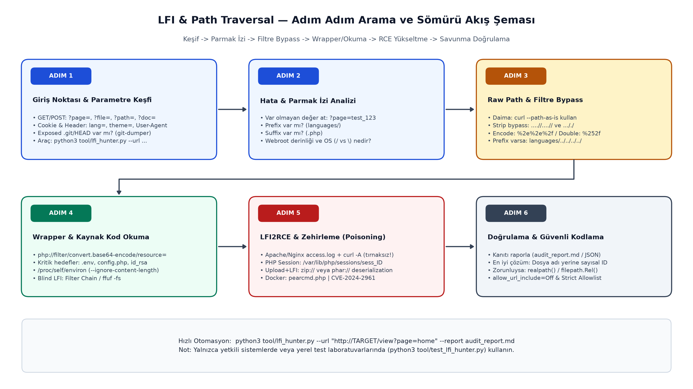

# 📂 01. LFI, RFI & Path Traversal + `LFI-Path-Hunter`

Local File Inclusion (**LFI**), Remote File Inclusion (**RFI**) ve **Path Traversal** zafiyetlerini adım adım arama metodolojisi, teknik rehber ve otomatik Python 3 denetim aracı.

---

## 🗺️ Adım Adım Nasıl Aranır?



1. **Adım 1 — Giriş Noktası & `.git` Kontrolü:** `?page=`, `?file=`, `?path=`, `?doc=`, `?lang=` parametrelerini, çerezleri ve `/.git/HEAD` açıklığını kontrol et.
2. **Adım 2 — Hata Parmak İzi (`?page=test_123`):** PHP `Warning` çıktısından **Prefix** (`languages/`), **Suffix** (`.php`), **Webroot derinliği** ve **OS** (`/` vs `\`) bilgisini çıkar.
3. **Adım 3 — `curl --path-as-is` & Bypass:** Tarayıcı ve normal `curl` `../` dizilerini siler; daima `--path-as-is` kullan (`....//`, `%252f`, `languages/../../../../../etc/passwd`).
4. **Adım 4 — Otomatik Tarama:**
   ```bash
   python3 tool/lfi_hunter.py --url "http://127.0.0.1:8080/view?page=home" --report audit_report.md
   python3 tool/test_lfi_hunter.py
   ```
5. **Adım 5 — Kaynak Kod & LFI2RCE:** `php://filter/convert.base64-encode/resource=config.php`, Log Poisoning (`curl -A`), Session Poisoning, `zip://`, `phar://` ve PHP Filter Chains.
6. **Adım 6 — Savunma:** Sayısal ID (`?id=1`), strict allowlist ve `realpath()` / `filepath.Rel()` ile containment.

---

## 📚 Modül Dosyaları
* **[Tam Teknik Rehber & Cheatsheet](docs/LFI_Adim_Adim_Teknik_Rehber.md)** *(Dil tuzakları, Blind Filter Chain, `CVE-2024-2961`, `pearcmd.php` dahil)*
* **[Derin Teknik PDF Rehberi](docs/HackTricks_LFI_RFI_Path_Traversal_Derin_Teknik_Rehber.pdf)**
* **[English Cheatsheet](docs/EN_Cheatsheet.md)**
* **`tool/`:** [`lfi_hunter.py`](tool/lfi_hunter.py) · [`demo_server.py`](tool/demo_server.py) · [`test_lfi_hunter.py`](tool/test_lfi_hunter.py) · [`sample_audit_report.md`](tool/sample_audit_report.md)
