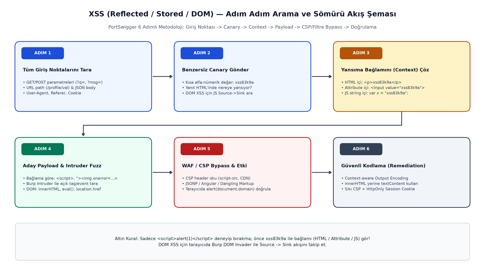

# ⚡ 03. XSS (Reflected / Stored / DOM) & CSP Bypass — Adım Adım Rehber

Bu modül; PortSwigger 6 adımlı XSS bulma metodolojisini, Burp Intruder tag fuzzing akışını ve DOM-Based XSS (`Source -> Sink`) + **Content Security Policy (CSP) Bypass** tekniklerini tek yerde toplar.

---

## 🗺️ Adım Adım Nasıl Aranır?



```mermaid
flowchart TD
    A["1. Giriş Noktaları (GET, POST, Path, Headers)"] --> B["2. Benzersiz Canary Gönder (xss83k9a)"]
    B --> C{"3. Yansıma Bağlamı (Context)?"}
    C -->|"HTML İçi (<p>val</p>)"| D["<script>alert(1)</script> / "]
    C -->|"Attribute (<input value='val'>)"| E["\">"]
    C -->|"JS String (var x='val')"| F["'-alert(1)-'"]
    B -->|"Sunucuya Yansımıyorsa: DOM XSS"| G["JS Kaynakta Source -> Sink Ara (innerHTML, eval)"]
    D & E & F & G --> H["4. WAF/CSP Varsa Bypass & Tarayıcıda Doğrula"]
```

---

## 1. PortSwigger 6 Adımlı XSS Arama Metodolojisi

1. **Adım 1 — Tüm Giriş Noktalarını Test Et:**
   * URL sorgu parametreleri (`?message=`, `?search=`)
   * POST gövdeleri (Form, JSON, XML)
   * URL dosya yolları (`/user/profile/val`) ve HTTP başlıkları (`User-Agent`, `Referer`, `Cookie`)
2. **Adım 2 — Rastgele Alfa-Nümerik Canary Gönder (`xss83k9a`):**
   * Basit doğrulamaları geçecek kadar kısa, yanıtta kolayca aranacak kadar benzersiz bir işaretçi gönder.
3. **Adım 3 — Yansıma Bağlamını (Reflection Context) Tespit Et:**
   * HTML etiketleri arası mı (`<p>xss83k9a</p>`)?
   * Etiket niteliği içi mi (`<input value="xss83k9a">`)?
   * JavaScript string değişkeni içi mi (`var name = "xss83k9a";`)?
4. **Adım 4 — Aday Payload & Burp Intruder ile Tag/Event Fuzzing:**
   * Canary'nin yanına aday payload ekle (`xss83k9a<script>alert(1)</script>`).
   * WAF/filtre varsa **Burp Intruder**'a `<§insertpayload§>` işaretleyip PortSwigger XSS Cheat Sheet'teki etiket ve `on*` olay listesini tara (`200 OK` dönen açık etiketleri yakala).
5. **Adım 5 — Filtre & CSP Atlatma (Evasion):**
   * `curl -sI https://target.com | grep -i content-security-policy` ile CSP başlığını oku.
   * **JSONP Bypass:** Beyaz listedeki domain'de (`accounts.google.com`) `?callback=alert(1337)`.
   * **Angular CSP Bypass:** `angular.js` CDN'i açıksa `ng-app` + `{{constructor.constructor('alert(1)')()}}`.
   * **`unsafe-eval` / Dangling Markup:** `img-src` açıksa `"> Sink`)

Sunucuya yansıma olmadan tamamen tarayıcı tarafında gerçekleşir. JS dosyalarını indirip şu ikiliyi ara:
* **Kaynaklar (Sources):** `location.hash`, `location.search`, `document.URL`, `document.referrer`, `window.name`, `postMessage`
* **Tehlikeli Alıcılar (Sinks):** `innerHTML`, `outerHTML`, `document.write()`, `eval()`, `setTimeout(str)`, `location.href`

```bash
# JS dosyalarında tehlikeli sink taraması
grep -rn "innerHTML\|outerHTML\|document\.write\|eval(\|setTimeout(\|location\.href" /path/to/js/
```

---

## 3. XSS Türleri ve Savunma (Remediation)

| Tür | Nasıl Çalışır? | Kalıcılık |
| :--- | :--- | :--- |
| **Reflected XSS** | Payload anlık HTTP isteğinden yanıt HTML'ine yansır | Tek istek (link ile tetiklenir) |
| **Stored XSS** | Payload veritabanına/yoruma kaydedilir, her ziyaretçide çalışır | Kalıcı (yüksek etki) |
| **DOM XSS** | İstemci JS'i `Source`'tan alıp `Sink`'e yazar | İstemci taraflı |
| **Self-XSS** | Yalnızca kullanıcının kendi konsol/input'a yapıştırmasıyla çalışır | Düşük etki |

**Savunma:** Bağlama duyarlı (context-aware) **Output Encoding**, `innerHTML` yerine **`textContent`**, sıkı **CSP** ve session çerezlerinde **`HttpOnly`** bayrağı.
