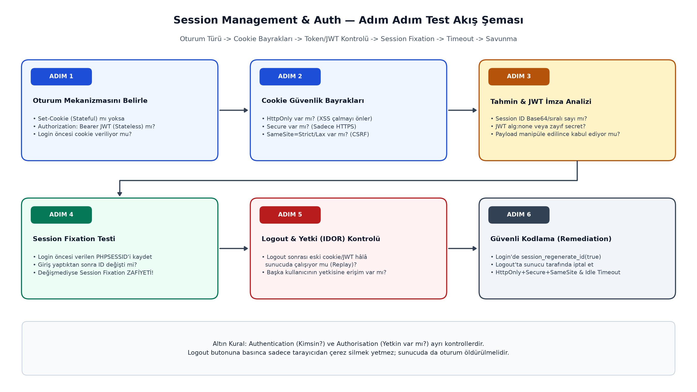
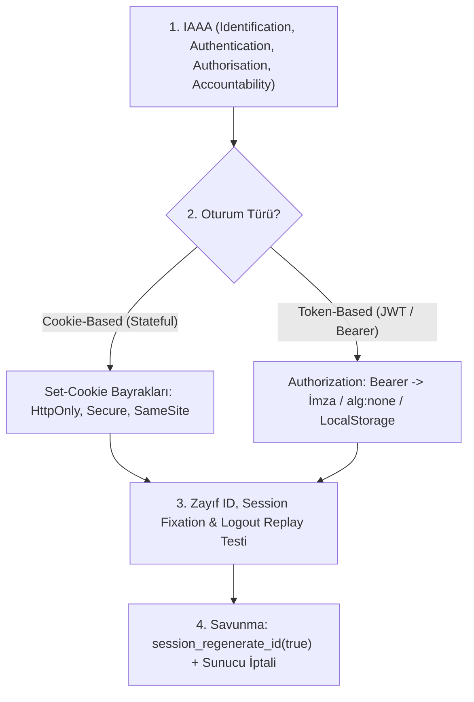

# 🔐 04. Session Management & Authentication — Adım Adım Test Rehberi

Bu modül; `wik sesion management` notlarının düzenlenmiş ve **adım adım oturum güvenliği test akışına** dönüştürülmüş halidir.

---

## 🗺️ Adım Adım Nasıl Test Edilir?

---

## 1. Temel Kavramlar (IAAA)
* **Identification:** Kullanıcının kim olduğunu iddia etmesi (kullanıcı adı).
* **Authentication (Doğrulama):** Kullanıcının gerçekten o kişi olduğunu kanıtlaması (parola / MFA).
* **Authorisation (Yetkilendirme):** Doğrulanan kullanıcının istenen işlemi yapma yetkisi olup olmadığının kontrolü. *(Herkes görebilir ama sadece admin silebilir.)*
* **Accountability:** Yapılan işlemlerin oturum ID'siyle birlikte loglanması.

---

## 2. Cookie-Based vs Token-Based (JWT)

| Özellik | Cookie-Based (Stateful) | Token-Based / JWT (Stateless) |
| :--- | :--- | :--- |
| **Durum** | Sunucu oturumu bellekte/DB'de tutar | Oturum verisi imzalı token içindedir |
| **İletim** | Tarayıcı her isteğe `Set-Cookie` değerini **otomatik ekler** | JS ile `Authorization: Bearer <JWT>` başlığında gönderilir |
| **Güvenlik Bayrakları** | `HttpOnly`, `Secure`, `SameSite` | `LocalStorage` (XSS riski) veya Secure Cookie |
| **Ana Risk** | **CSRF** (Cross-Site Request Forgery) | XSS ile token çalınması, imzasız JWT (`alg: none`) |

---

## 3. Adım Adım Session Test Listesi
1. **Cookie Bayraklarını Kontrol Et:** `Set-Cookie` başlığında `HttpOnly` (JS erişimini kapatır), `Secure` (sadece HTTPS) ve `SameSite=Strict/Lax` (CSRF engeli) var mı?
2. **Tahmin Edilebilir Session ID:** Session değeri sadece kullanıcı adının Base64 hali veya artan sayı mı?
3. **Session Fixation:** Giriş yapmadan önce sunucunun verdiği `PHPSESSID` değerini kaydet. Başarılı login sonrası Session ID **yenileniyor (rotate ediliyor)** mu? Yenilenmiyorsa saldırgan kendi verdiği ID ile kurbanın yetkili oturumunu devralabilir!
4. **JWT İmza Doğrulaması:** Token payload'ını değiştirip imzayı silince (`alg: none`) sunucu isteği hâlâ kabul ediyor mu?
5. **Logout & Timeout Testi:** Çıkış yaptıktan sonra eski cookie veya JWT sunucuda **gerçekten iptal ediliyor mu**, yoksa replay edildiğinde hâlâ çalışıyor mu?

---

## 4. Güvenli Kodlama (Remediation)
* Başarılı login anında mutlaka **`session_regenerate_id(true)`** ile yeni Session ID üret.
* Cookie'lerde **`HttpOnly; Secure; SameSite=Lax`** zorunlu tut.
* Logout işleminde çerezi sadece tarayıcıdan silme, **sunucu tarafında da geçersiz kıl** ve idle/absolute timeout uygula.
