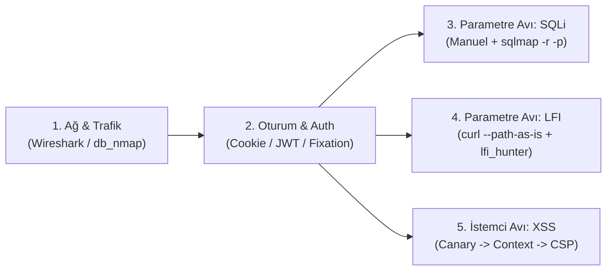

# 🛡️ Web Security & Pentest WİK Playbook (`web-security-pentest-wiki`)

Tüm **`WİK` (What I Know)** siber güvenlik notlarının, **adım adım zafiyet arama rehberlerinin**, **görsel av akış şemalarının** ve **LFI otomasyon aracının (`LFI-Path-Hunter`)** tek çatı altında toplandığı birleşik teknik bilgi ve saha deposudur.

> **Yasal Uyarı:** Bu depodaki tüm teknikler ve araçlar yalnızca kendi sahip olduğunuz sistemler, TryHackMe / PortSwigger / CTF laboratuvarları veya yazılı izniniz bulunan yetkili güvenlik testleri içindir.

---

## 📂 Konu Grupları ve Hızlı Erişim

Her klasörde o zafiyet/konu için **(1) Teknik Mantık**, **(2) Adım Adım "Nasıl Aranır?" Akış Şeması**, **(3) Pratik Komut / Payload Matrisi** ve **(4) Güvenli Kodlama (Remediation)** bölümleri yer alır:

| # | Modül / Klasör | İçerik ve Kaynaklar | Görsel Akış Şeması |
| :---: | :--- | :--- | :--- |
| **01** | **[`01_LFI_Path_Traversal/`](01_LFI_Path_Traversal/README.md)** | LFI/RFI & Path Traversal rehberi, Go/Python/TCPDF dil tuzakları, `php://filter`, Log/Session Poisoning, `HackTricks` PDF ve **`tool/lfi_hunter.py`** | [`assets/lfi_hunting_workflow.png`](assets/lfi_hunting_workflow.png) |
| **02** | **[`02_SQL_Injection_SQLMap/`](02_SQL_Injection_SQLMap/README.md)** | SQL temelleri, String vs Sayısal (Non-String) SQLi, Time-Based gecikme matematiği, UNION, Burp `req.txt` + `sqlmap -r -p` ve `--os-shell` | [`assets/sqli_hunting_workflow.png`](assets/sqli_hunting_workflow.png) |
| **03** | **[`03_XSS_Cross_Site_Scripting/`](03_XSS_Cross_Site_Scripting/README.md)** | PortSwigger 6 adımlı XSS arama metodolojisi, Reflection Context, Burp Intruder fuzzing, DOM XSS (`Source -> Sink`) ve CSP Bypass | [`assets/xss_hunting_workflow.png`](assets/xss_hunting_workflow.png) |
| **04** | **[`04_Session_Management/`](04_Session_Management/README.md)** | IAAA, Cookie-Based vs Token-Based (JWT), `HttpOnly`/`Secure`/`SameSite`, Session Fixation, zayıf ID ve Logout iptal testleri | [`assets/session_hunting_workflow.png`](assets/session_hunting_workflow.png) |
| **05** | **[`05_Network_Wireshark_Metasploit/`](05_Network_Wireshark_Metasploit/README.md)** | Wireshark katmanlı analiz, Red Herring ayıklama, DNS Exfiltration (`tshark`), Metasploit 4 adımlı döngü (`db_nmap -> hosts -R -> exploit`) | [`assets/network_pentest_workflow.png`](assets/network_pentest_workflow.png) |

---

## 🧭 Genel Bakış: Bir Hedefe Girerken Sırayla Ne Yapılır?



* **Otomatik LFI Tarama Testi:**
  ```bash
  python3 01_LFI_Path_Traversal/tool/test_lfi_hunter.py
  python3 01_LFI_Path_Traversal/tool/lfi_hunter.py --url "http://127.0.0.1:8080/view?page=home" --report audit_report.md
  ```
