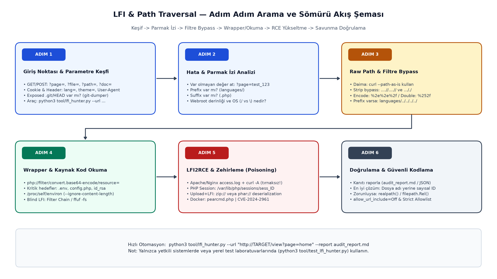
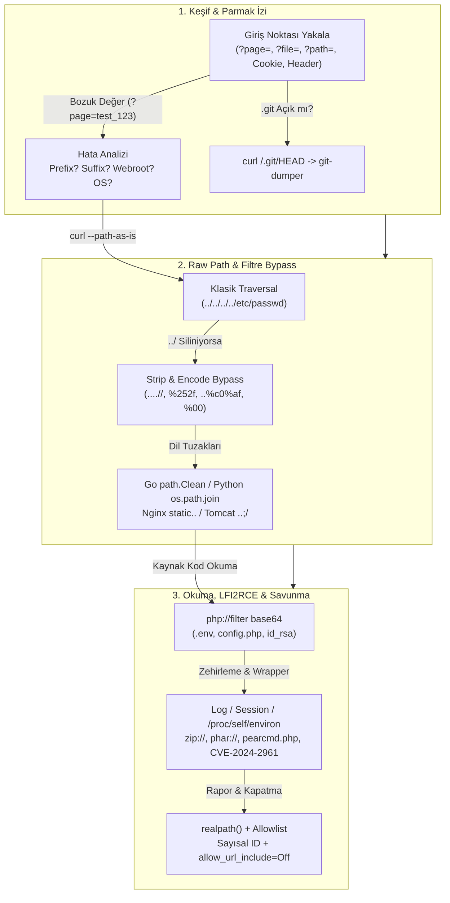

# 🛡️ Web Security LFI & Path Traversal Guide + `LFI-Path-Hunter`

Local File Inclusion (**LFI**), Remote File Inclusion (**RFI**) ve **Path Traversal** zafiyetlerini **adım adım tespit etmek, filtreleri aşmak, sömürmek (LFI2RCE) ve güvenli kodlama ile kapatmak** için birleştirilmiş teknik saha rehberi ve otomatik denetim aracı.

> **Yasal Uyarı:** Bu depo yalnızca kendi sahip olduğunuz sistemler, eğitim laboratuvarları (TryHackMe, PortSwigger, HTB) veya yazılı izniniz bulunan yetkili güvenlik testleri için hazırlanmıştır.

---

## 🗺️ Adım Adım Nasıl Aranır? (Görsel Akış Şeması)





---

## 📂 Depo Yapısı (Hepsi Tek Çatı Altında)

| Klasör / Dosya | İçerik |
| :--- | :--- |
| [`docs/LFI_Adim_Adim_Teknik_Rehber.md`](docs/LFI_Adim_Adim_Teknik_Rehber.md) | **Ana Türkçe Teknik Rehber + Cheatsheet:** Adım adım arama metodolojisi, bypass matrisi, dil tuzakları (Go/Python/Java/TCPDF), PHP wrapper'lar, LFI2RCE teknikleri ve savunma. |
| [`docs/HackTricks_LFI_RFI_Path_Traversal_Derin_Teknik_Rehber.pdf`](docs/HackTricks_LFI_RFI_Path_Traversal_Derin_Teknik_Rehber.pdf) | **Derin Teknik PDF Rehberi:** Kapsamlı LFI/RFI/Path Traversal başvuru kitabı. |
| [`docs/EN_Cheatsheet.md`](docs/EN_Cheatsheet.md) | **English Reference:** Kısa İngilizce hızlı başvuru özeti. |
| [`assets/lfi_hunting_workflow.png`](assets/lfi_hunting_workflow.png) | **Adım Adım Arama Akış Şeması:** 6 adımlı görsel av metodolojisi. |
| [`tool/lfi_hunter.py`](tool/lfi_hunter.py) | **Otomatik Denetim Aracı:** `--path-as-is` davranışlı, sıfır harici bağımlılıklı Python 3 CLI denetçisi. |
| [`tool/demo_server.py`](tool/demo_server.py) & [`tool/test_lfi_hunter.py`](tool/test_lfi_hunter.py) | **Yerel Lab & Doğrulama Testi:** Zafiyetli vs yamalı sunucu üzerinde otomatik regresyon testi. |
| [`tool/sample_audit_report.md`](tool/sample_audit_report.md) | Örnek denetim çıktısı. |

---

## ⚡ Hızlı Başlangıç: Ararken Adım Adım Ne Yapacaksın?

1. **Adım 1 — Giriş Noktası & `.git` Kontrolü:** URL'deki `?page=`, `?file=`, `?path=`, `?doc=`, `?lang=` parametrelerini, gizli form alanlarını ve çerezleri yakala. Önce `/.git/HEAD` açık mı bak.
2. **Adım 2 — Hata Parmak İzi (`?page=test_123`):** Var olmayan bir dosya gönderip `Warning` mesajından **Prefix** (`languages/`), **Suffix** (`.php`), **Webroot derinliği** (`/var/www/html/`) ve **OS** (`/` vs `\`) bilgisini çıkar.
3. **Adım 3 — `curl --path-as-is` & Bypass:** Tarayıcı ve normal `curl` `../` dizilerini siler; mutlaka `--path-as-is` kullan. Filtre varsa `....//....//`, `%252f` veya prefix ekli (`languages/../../../../../etc/passwd`) dene.
4. **Adım 4 — Otomatik Tarama (`lfi_hunter.py` / `ffuf`):**
   ```bash
   # Otomatik LFI & Path Traversal denetimi (Top-25 parametre + çoklu bypass)
   python3 tool/lfi_hunter.py --url "http://127.0.0.1:8080/view?page=home" --report audit_report.md

   # Yerel zafiyetli vs yamalı doğrulama testini çalıştır
   python3 tool/test_lfi_hunter.py
   ```
5. **Adım 5 — Kaynak Kod & LFI2RCE:** Sadece `/etc/passwd` okuyup durma; `php://filter/convert.base64-encode/resource=config.php` ile şifreleri çek, gerekiyorsa Log Poisoning (`curl -A`), Session Poisoning, `zip://`, `phar://` veya PHP Filter Chain ile RCE dene.
6. **Adım 6 — Güvenli Kodlama (Remediation):** Kullanıcıdan dosya adı yerine sayısal ID (`?id=1`) al; zorunluysa `realpath()` / `filepath.Rel()` ile kanonikleştirme + strict allowlist uygula.

👉 Tüm teknik detaylar, kopyala-yapıştır komutlar ve dil bazlı kod inceleme tuzakları için **[Ana Teknik Rehber'e (`docs/LFI_Adim_Adim_Teknik_Rehber.md`)](docs/LFI_Adim_Adim_Teknik_Rehber.md)** geçebilirsin.
